  

# Hi, I'm Dariusz

**AI Engineer · Agentic Software Delivery · Multi-Agent Systems · RAG · MCP · QA roots**

My first line of code was on a Commodore 64. I thought I was starting a game.

Today I run teams of AI agents that ship software - and I build the gates that keep it safe.

**My rule: context before LLM.**
Most "AI for QA" content says *"let AI write your tests"*.
I do the opposite - deterministic pipelines first, the model only where judgment adds value.

🇵🇱 Warsaw, Poland · Remote · B2B · [darek@sdet.it](mailto:darek@sdet.it)

---

## Proof, not adjectives

- **SaaS platform (web panel + mobile app)** - first merge to alpha testing in under 3 weeks. 723 planned tasks, 1,000+ merged PRs, 5,000+ CI runs, thousands of tests on every run. Bug report to merged fix: 28 minutes at best.
- **AI review gate for a whole team** - every MR gets its own worktree and 20-35 targeted mutations in production code. A surviving mutation means no approve. Caught a hardcoded ID that passed 1,320 frontend tests.
- **WCAG 2.2 AA** - my own portfolio from grade F to A in 8 commits. Multi-page run: 5,816 findings down to 7 across 35 pages after 4 CSS commits.

What I learned: agents write code faster than it can be safely merged. The bottleneck is process - CI queue, migration order, review gates.

## Now

- Tech lead, AI engineering - taking a logistics platform from working to production-grade with an agentic delivery pipeline
- Open to remote B2B projects: AI engineering, agentic delivery, AI implementation

---

## What I'm building

- **[sdet-wcag-toolkit](https://github.com/darco81/sdet-wcag-toolkit)** - Static + dynamic analysis + 5 AI specialists for WCAG 2.2 AA audits, A-F grading. AGPL-3.0.
- **[skills-radar](https://github.com/darco81/skills-radar)** - Skill router for AI coding agents over MCP. Hybrid BM25 + semantic retrieval, fully local on Apple Silicon (MLX) or Docker. MIT, on PyPI.
- **[sdet-brain](https://github.com/darco81/sdet-brain)** - Persistent RAG for a personal Markdown corpus. Local-first MLX + Qdrant, MCP server.
- **[jarvis-brain-core](https://github.com/darco81/jarvis-brain-core)** - Code-graph context over MCP for coding agents. Educational distillate. AGPL-3.0.
- **[sdet-perf-toolkit](https://github.com/darco81/sdet-perf-toolkit)** - Context-first frontend performance audit. In-browser Lighthouse + web-vitals + trace, read by 5 AI specialists. AGPL-3.0.
- **[cdat-pattern](https://github.com/darco81/cdat-pattern)** - Components-Data-Actions-Tests. 4-layer architecture for maintainable Playwright suites, 3,000+ tests across 9 production systems. MIT.

**Live**

- **[portfolio.sdet.it](https://portfolio.sdet.it)** - Case studies + "From the field" series (EN)
- **[portfolio.sdet.pl](https://portfolio.sdet.pl)** - PL version
- **[sdet.it](https://sdet.it)** - Services portal *(in progress)*

---

## Tech Stack

**Languages & Runtimes**

**AI / RAG / Agents**

-000000?style=flat-square&logoColor=white)

**Testing & QA**

**Frontend & Backend**

**Infra**

---

## GitHub Stats

  <picture>
    <source media="(prefers-color-scheme: dark)" srcset="./profile/stats-dark.svg">
    
  </picture>
  <picture>
    <source media="(prefers-color-scheme: dark)" srcset="./profile/top-langs-dark.svg">
    
  </picture>

  <picture>
    <source media="(prefers-color-scheme: dark)" srcset="./profile/activity-dark.svg">
    
  </picture>

---

## Find me

